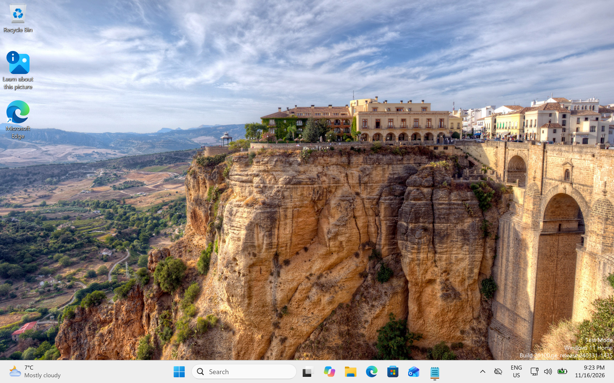

# BridgeVM

[](https://github.com/Ketchio-dev/bridgevm/actions/workflows/ci.yml)
[](https://github.com/Ketchio-dev/bridgevm/actions/workflows/security-quality.yml)
[](LICENSE)

**Windows 11 Arm on Apple silicon, in a native Mac app.**

BridgeVM runs Windows alongside macOS using its own
[Hypervisor.framework VMM](crates/bridgevm-hvf/), without QEMU. It is the
app's only engine.

**Current access: [General Preview v0.1.0](https://github.com/Ketchio-dev/bridgevm/releases/tag/v0.1.0) · Engineering Preview · 3D-off.**
Install it with the terminal installer or the DMG. The app is ad-hoc signed,
not notarized.

```sh
curl -fsSL https://raw.githubusercontent.com/Ketchio-dev/bridgevm/main/install.sh | bash
```

**[Install guide](docs/install.md)** ·
**[Build from source](docs/install.md#build-the-current-source)** ·
**[Set up Windows](docs/install.md#what-you-need-after-installing)** ·
**[Current status](STATUS.md)** · **[Contribute](CONTRIBUTING.md)**

<p align="center">
  <a href="docs/media/windows-hvf-desktop-20261116.webp">
    
  </a><br>
  <sub>Actual development VM · November 16, 2026 · 2560×1600 lossless capture · <a href="docs/media/windows-hvf-desktop-20261116.webp">Open full resolution</a></sub><br>
  <sub>The visible Windows Test Mode watermark belongs to this VM's experimental display driver; this is not a public release screenshot.</sub>
</p>

## What you can try

| Area | Current scope |
| --- | --- |
| Windows desktop | Windows 11 Arm on BridgeVM's native HVF engine; create a VM from an ISO or import an installed disk. |
| Display and input | A native Mac window, keyboard and mouse, local text composition, and configurable Command-key mapping. Window-following resolution needs the guest display driver and a restart. |
| Mac integration | Clipboard sharing, shared folders, networking and audio output. Display smoothness and audio continuity still need broader validation. |
| VM lifecycle | Start, shut down and restart; persistent storage and TPM/Secure Boot workflows; [powered-off snapshots](docs/windows-arm/snapshot-scope-v1.md). Running-state suspend is outside v1. |

These are preview capabilities. ISO installation and installed-disk import on
a clean Mac remain the open release criterion. The
[capability matrix](docs/windows-arm/capability-matrix.md) records the evidence
for each feature.

To send a draft to the focused Windows editor, open the running VM's **HVF
Engine** view, enter the text in **Windows에 입력할 텍스트**, and select **입력**.
The field keeps the draft while it waits for an input receipt or a clipboard
paste. If the editor declines queued dispatch for a multiline draft, the app
checks the text on the Windows clipboard and sends one paste. The legacy
keyboard route also uses the clipboard for characters it cannot type. Either
clipboard route replaces the previous Windows clipboard copy.

Compatible Windows editors such as Notepad and WinForms RichTextBox use queued
text dispatch. Some editors and older agents use per-character input. If a
long passage loses characters on that path, use clipboard sharing and paste.
The application readback, saved-file and Undo checks for WPF and Edge are
recorded in [#665](https://github.com/Ketchio-dev/bridgevm/issues/665).

## Try BridgeVM

**Host:** Apple silicon and macOS 15+ (the engine uses the macOS 15
Hypervisor.framework GIC). The declared host matrix is M4/M5;
M1–M3 are not yet covered. The [installation guide](docs/install.md) has the
terminal installer, the DMG and its one-time Open Anyway step. Source builds
require Xcode/Swift, Rust 1.85+ and pinned native dependencies; follow the
complete [build and packaging guide](docs/install.md#build-the-current-source),
because `cargo build` and `swift build` alone do not prepare a
Windows-installation app.

Choose the Windows setup path that matches what you have:

| Starting point | What you provide |
| --- | --- |
| **Install from ISO** | Your own licensed Windows 11 Arm ISO. On your click the app downloads the Microsoft-signed Red Hat virtio-win storage/serial/network drivers (about 95 MB) from the official source and checks them against a pinned SHA-256; you can still choose your own signed ARM64 driver folder and manifest instead. One live install from an ISO with the downloaded drivers reached Windows setup with storage, serial and network working (2026-11-20, development Mac); a clean-Mac run through the app is not yet recorded. |
| **Import an installed VM** | A Windows 11 Arm disk in RAW, QCOW2 or Hyper-V VHDX format. Import needs no driver payload. |

In current source builds, quitting during import offers **Finish Then Quit**
(`완료 후 종료`). You can cancel the pending quit in the import progress view.

The [installation guide](docs/install.md) covers both paths, required bundle
resources and first-open trust. After Windows starts, install the signed guest
display driver from the VM's settings and restart to enable window-following
resolution.

Release and source builds are ad-hoc signed. Developer ID signing and Apple
notarization remain unfinished. Standard preview packaging includes no Windows
test driver and requires no TESTSIGNING setup.

## Engineering Preview

Current work focuses on reliable Retina/window transitions, input and clipboard
ordering, audio/display continuity, and lifecycle recovery. Experimental
[selectable virtual refresh rates](https://github.com/Ketchio-dev/bridgevm/pull/660)
are being developed with a separate Windows driver. They are not a supported
General Preview feature; a virtual Hz setting does not establish rendered FPS
or a physical display's refresh rate. GPU/3D acceleration remains a
[Graphics Lab research path](docs/distribution-channels.md).
That experimental path still has
[known title, tab and menu glyph defects](docs/windows-arm/evidence/windows-glyph-text-integer-attributes-20260814.md).

The dated registry snapshot below is the detailed validation record. Later code
changes need their own checks and hardware evidence.

<details>
<summary>Detailed capability status and known defects</summary>

<!-- BEGIN GENERATED: capability-summary -->
**Product state: Engineering Preview.** Runs an installed Windows 11 Arm desktop on BridgeVM's own Hypervisor.framework VMM with persistent storage, display/input, network, audio, clipboard and folder integration, TPM/Secure Boot workflows, snapshots and window Coherence verbs. 3D acceleration is excluded from General Preview and v1; release-blocking evidence remains open and known defects are disclosed below.

Release scenarios met: **3 / 5**.

| ID | Scenario | State | Criteria | Known defects |
| --- | --- | --- | --- | --- |
| S1 | Get Windows running | `OPEN` | A9 (open), A1, A10 | **A9**: No retained clean-machine product-flow receipt yet proves either ISO installation or installed-disk import through the app. Both supported flows remain 3D-off. In the 3D-off configuration the app's live display window was choppy in recent hardware runs; its smoothness has not been measured since. Guest audio stuttered audibly: until 2026-11-03 every other 10 ms of Windows playback reached the host as silence, because the sound controller answered Windows' position reads at the 0x2084 alias with 0. Since that fix, 60-second live runs had 2-6 silent 10 ms blocks out of about 6,330, and under host load 0-8 blocks per run still repeated stale audio; at the v1.1.0 release head (2026-11-14) six such runs had 2-6 silent and 0-3 stale blocks out of about 6,400, and one of them had 2 host underrun callbacks. No listening check has confirmed the stutter is gone. |
| S2 | Use the Windows desktop | `OPEN` | A4, B4, A5, A8 | The Windows display follows the window size only after the one-time display driver install in the VM view (Red Hat virtio-win, Microsoft-signed, downloaded by the guest) and a VM restart; until then the resolution is fixed per VM before it starts (1280x800 by default, up to 2560x1600). The app window was choppy in earlier runs and its smoothness has not been measured since, and no listening check has confirmed that the audio stutter is gone (see A9). |
| S3 | Work with the Mac | `MET` | A6, A7 | none |
| S4 | Keep the VM safe | `MET` | A19, A15, A16, A12 | none |
| S5 | Go online | `MET` | A20 | none |

Release-blocking criteria proven: **13 / 14**. Open: A9.

Other known open defects:
- **B6**: Window title, tab and menu glyphs can be blank on the experimental Windows graphics path; body text alone does not prove glyph correctness.

- Graphics future path: Vulkan is a Graphics Lab future path, excluded from General Preview and v1; D3D11 compatibility is a Graphics Lab future path, excluded from General Preview and v1.
- Guest platform: QEMU virt-compatible guest contract with documented deviations.

State reviewed 2026-11-24 at commit `084d07c8ab24d2fc9d4e704a0b738af9d2f924d9`. This block is generated from [`capabilities/windows-hvf.json`](capabilities/windows-hvf.json) by `scripts/render-capability-status.py`.
<!-- END GENERATED: capability-summary -->

</details>

## Develop the VMM

Control test VMs from the terminal with the [native app CLI](docs/app-cli.md)
and [guest development CLI](docs/vmctl.md): start/stop/status, PowerShell,
keyboard/mouse input, display-mode requests and 2D PNG captures.

Start with [CONTRIBUTING.md](CONTRIBUTING.md) for toolchains and focused checks,
[AGENTS.md](AGENTS.md) for working rules, and the
[machine contract](docs/machine-contract/qemu-virt.md) for guest-visible behavior.

| Area | Source |
| --- | --- |
| Hypervisor.framework VMM and devices | [`crates/bridgevm-hvf/`](crates/bridgevm-hvf/) |
| Windows HVF runtime lifecycle | [`crates/bridgevm-hvf-runtime/`](crates/bridgevm-hvf-runtime/), [`runners/hvf-runner/`](runners/hvf-runner/) |
| Disk and vars media leases | [`crates/bridgevm-media/`](crates/bridgevm-media/) |
| `bridgevm` CLI (`app …` commands, `hvf` reports) | [`crates/bridgevm-cli/`](crates/bridgevm-cli/) |
| Mac app and helper boundaries | [`apps/macos/`](apps/macos/) |
| Packaging and release verification | [`apps/macos/scripts/package-hvf-control-app.sh`](apps/macos/scripts/package-hvf-control-app.sh), [`release.yml`](.github/workflows/release.yml) |
| Deterministic checks and live tests | [`scripts/`](scripts/), [`tests/integration/`](tests/integration/) |

Use focused tests while making a change. The fast project check covers
formatting, contracts and documentation; release candidates run the full check:

```sh
scripts/check-project.sh --fast
scripts/check-project.sh
```

Deterministic CI runs on GitHub-hosted runners. Windows boots, HVF behavior and
clean-machine product journeys need the corresponding
[physical-Mac tests](docs/testing/apple-silicon-live-gates.md).

## Engine

The app has one engine, Windows HVF: Hypervisor.framework plus BridgeVM's own
device model. The earlier Apple VZ (Linux) and QEMU compatibility engines were
removed; a VM saved with one of them stays in the library, marked as no longer
supported, with its files untouched, and can be deleted from there.

Windows HVF uses a QEMU `virt`-compatible guest contract with
[documented deviations](docs/machine-contract/qemu-virt-deviations.json).
BridgeVM imports RAW, QCOW2 and VHDX disks with its bundled converter.
The current source also reads QCOW2 images made with QEMU's default deflate
compression. Convert zstd-compressed or encrypted images to RAW first, and
merge disks that depend on a backing file in their original VM app.

## More information

- [Documentation](docs/README.md) — guides, plans and dated engineering records.
- [Current status](STATUS.md) — priorities, evidence and known limitations.
- [Security model](docs/security/model.md) and [private vulnerability reporting](SECURITY.md).
- [Good first issues](https://github.com/Ketchio-dev/bridgevm/labels/good%20first%20issue)
  and [contribution guide](CONTRIBUTING.md).

## License

BridgeVM is licensed under [Apache-2.0](LICENSE). Third-party components retain
their own licenses; see [THIRD-PARTY-NOTICES.md](THIRD-PARTY-NOTICES.md) and the
[licensing guide](docs/licensing-and-attribution.md).

Copyright © 2026 Ketchio-dev.
