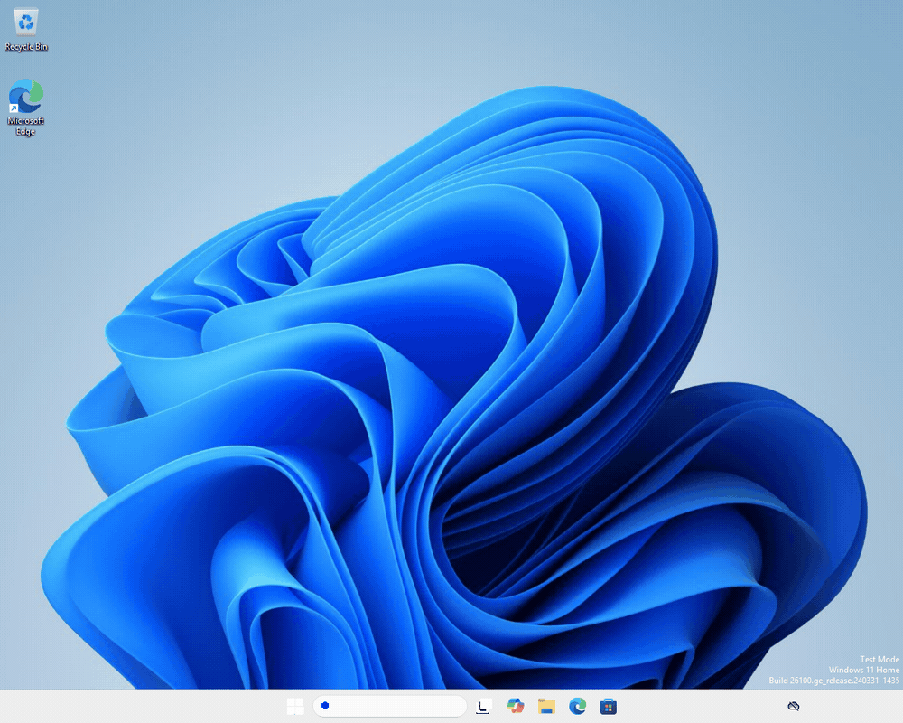

# BridgeVM

[](https://github.com/Ketchio-dev/bridgevm/actions/workflows/ci.yml)
[](https://github.com/Ketchio-dev/bridgevm/actions/workflows/security-quality.yml)
[](LICENSE)

**Run Windows 11 Arm on Apple silicon with a Mac-native, QEMU-free
Hypervisor.framework VMM.**

<p align="center">
  
</p>

BridgeVM develops its own Windows 11 Arm VMM on Apple's Hypervisor.framework.
The main engineering focus is CPU execution, interrupts and timers, device I/O,
and VM lifecycle reliability. Apple VZ and QEMU compatibility backends remain
separate engine paths.

**[Install the General Preview](docs/install.md)** ·
**[Build the current source](docs/install.md#build-the-current-source)** ·
**[Current status](STATUS.md)** · **[Contribute](CONTRIBUTING.md)** ·
**[Documentation](docs/README.md)**

## Engineering Preview

Product wording and known defects come from the capability registry. Its dated
snapshot describes retained evidence, not a guarantee for every later commit:

<!-- BEGIN GENERATED: capability-summary -->
**Product state: Engineering Preview.** Runs an installed Windows 11 Arm desktop on BridgeVM's own Hypervisor.framework VMM with persistent storage, display/input, network, audio, clipboard and folder integration, TPM/Secure Boot workflows, snapshots and window Coherence verbs. 3D acceleration is excluded from General Preview and v1; release-blocking evidence remains open and known defects are disclosed below.

Release scenarios met: **2 / 5**.

| ID | Scenario | State | Criteria | Known defects |
| --- | --- | --- | --- | --- |
| S1 | Get Windows running | `OPEN` | A9 (open), A1, A10 | **A9**: No retained clean-machine product-flow receipt yet proves either ISO installation or installed-disk import through the app. Both supported flows remain 3D-off. In the 3D-off configuration the app's live display window was choppy in recent hardware runs; its smoothness has not been measured since. Guest audio stuttered audibly: until 2026-11-03 every other 10 ms of Windows playback reached the host as silence, because the sound controller answered Windows' position reads at the 0x2084 alias with 0. Since that fix, 60-second live runs had 2-6 silent 10 ms blocks out of about 6,330 and no host underruns, and under host load 0-8 blocks per run still repeated stale audio; no listening check has confirmed the stutter is gone. |
| S2 | Use the Windows desktop | `OPEN` | A4, B4, A5, A8 | The Windows display follows the window size only after the one-time display driver install in the VM view (Red Hat virtio-win, Microsoft-signed, downloaded by the guest) and a VM restart; until then the resolution is fixed per VM before it starts (1280x800 by default, up to 2560x1600). The app window was choppy in earlier runs and its smoothness has not been measured since, and no listening check has confirmed that the audio stutter is gone (see A9). |
| S3 | Work with the Mac | `MET` | A6, A7 | none |
| S4 | Keep the VM safe | `OPEN` | A19 (open), A15, A16, A12 | **A19**: Legacy managed storage relocated before identity migration is refused. Full interrupted-operation coverage is unproven. The ten-lane product lifecycle campaign passed 10/10 once, at 949f4c26, which the operator accepted before a release head was designated. Physical power loss during a snapshot operation is outside this criterion and is not tested. |
| S5 | Go online | `MET` | A20 | none |

Release-blocking criteria proven: **12 / 14**. Open: A9, A19.

Other known open defects:
- **B6**: Window title, tab and menu glyphs can be blank on the experimental Windows graphics path; body text alone does not prove glyph correctness.

- Graphics future path: Vulkan is a Graphics Lab future path, excluded from General Preview and v1; D3D11 compatibility is a Graphics Lab future path, excluded from General Preview and v1.
- Guest platform: QEMU virt-compatible guest contract with documented deviations.

State reviewed 2026-11-14 at commit `c4f4e9cbeb6fc27caf2a9ba24ec624592da1f01c`. This block is generated from [`capabilities/windows-hvf.json`](capabilities/windows-hvf.json) by `scripts/render-capability-status.py`.
<!-- END GENERATED: capability-summary -->

The [capability matrix](docs/windows-arm/capability-matrix.md) contains the fixed
thresholds and exact receipts. Test results and live guest evidence are tracked
separately; a documentation update does not renew either.

## Try BridgeVM

The General Preview `v1.1.0` is the current downloadable build: install it with
the terminal installer or the DMG as described in the
[installation guide](docs/install.md). The older `v1.0.0` predates the
fail-closed driver policy and is refused by the installer. To build from
source instead, use the [source-build guide](docs/install.md#build-the-current-source)
and [development setup](CONTRIBUTING.md#set-up-a-development-checkout).

Requirements: Apple-silicon Mac with macOS 14+; building from source also needs
Xcode/Swift and Rust 1.85+.
Host coverage is limited; see [known limitations](STATUS.md#known-limitations).

To install Windows, bring your own licensed Windows 11 Arm ISO and a signed
ARM64 storage/serial/network driver payload with an external SHA-256 manifest;
an ISO alone is insufficient. To import instead, bring an installed Windows 11
Arm disk (RAW, QCOW2 or Hyper-V VHDX); import needs no driver payload. The
[installation guide](docs/install.md) explains the
payload contract, bundle dependencies, and local ad-hoc-signed build. The
General Preview contains no Windows test driver, does not enable TESTSIGNING,
and keeps 3D acceleration outside the release scope.

The Mac app is not Developer ID signed or Apple-notarized. A DMG downloaded in
a browser needs the one-time
[Open Anyway step](docs/install.md#dmg-from-the-releases-page); the copy the
terminal installer fetches does not. Running-state suspend is outside v1;
see the [powered-off snapshot scope](docs/windows-arm/snapshot-scope-v1.md).

## Develop the VMM

Start with [CONTRIBUTING.md](CONTRIBUTING.md) for toolchains and focused checks,
[AGENTS.md](AGENTS.md) for evidence and safety rules, and the
[machine contract](docs/machine-contract/qemu-virt.md) for guest-visible behavior.

| Area | Source |
| --- | --- |
| Own Hypervisor.framework VMM and devices | [`crates/bridgevm-hvf/`](crates/bridgevm-hvf/) |
| Windows HVF runtime lifecycle | [`crates/bridgevm-hvf-runtime/`](crates/bridgevm-hvf-runtime/), [`runners/`](runners/) |
| Mac app and helper boundaries | [`apps/macos/`](apps/macos/) |
| App packaging and release verification | [`packaging/macos/`](packaging/macos/) |
| Deterministic checks and sealed live gates | [`scripts/`](scripts/), [`tests/integration/`](tests/integration/) |

For quick deterministic feedback, run `scripts/check-project.sh --fast`.
Run the complete gate before treating a repository change as done:

```sh
scripts/check-project.sh
```

Deterministic checks run on GitHub-hosted CI. Real Windows boots,
Hypervisor.framework behavior and clean-machine product journeys require the
corresponding sealed [physical-Mac live gate](docs/testing/apple-silicon-live-gates.md).

## Engine boundaries

| Engine | Backend | Focus |
| --- | --- | --- |
| **Windows HVF** | Hypervisor.framework + BridgeVM device model | Main Windows 11 Arm engineering path |
| **Apple VZ** | Virtualization.framework | Narrow Linux/macOS Arm path |
| **Compatibility** | QEMU + HVF/TCG | Compatibility and architecture emulation |

The Windows guest platform is a QEMU `virt`-compatible contract with
[documented deviations](docs/machine-contract/qemu-virt-deviations.json).
The Compatibility Engine also uses QEMU's `qemu-img` for its qcow2 disk
operations. Windows HVF import does not need QEMU: it takes RAW, QCOW2 or
Hyper-V VHDX disks and converts QCOW2 and VHDX to RAW with BridgeVM's own
converter. A disk using compression, encryption or a backing file is refused,
and the app says how to convert it with `qemu-img` first.

Graphics Lab is a separate future research path, excluded from General Preview
and v1. Its retained campaigns include
[known glyph defects](docs/windows-arm/evidence/windows-glyph-text-integer-attributes-20260814.md).
Read the [distribution channel contract](docs/distribution-channels.md) before
using its test-signed packages on disposable guests.

## More information

- [Documentation index](docs/README.md) — current guides, plans, and dated history.
- [Current status](STATUS.md) — priorities, open criteria, and evidence limits.
- [Security model](docs/security/model.md) and [private vulnerability reporting](SECURITY.md).
- [Good first issues](https://github.com/Ketchio-dev/bridgevm/labels/good%20first%20issue)
  and [contribution guide](CONTRIBUTING.md).

## License

BridgeVM is licensed under [Apache-2.0](LICENSE). Third-party components retain
their own licenses; see [THIRD-PARTY-NOTICES.md](THIRD-PARTY-NOTICES.md) and the
[licensing guide](docs/licensing-and-attribution.md).

Copyright © 2026 Ketchio-dev.
